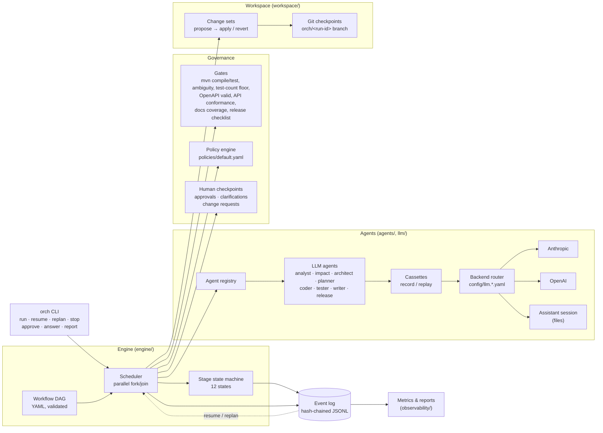
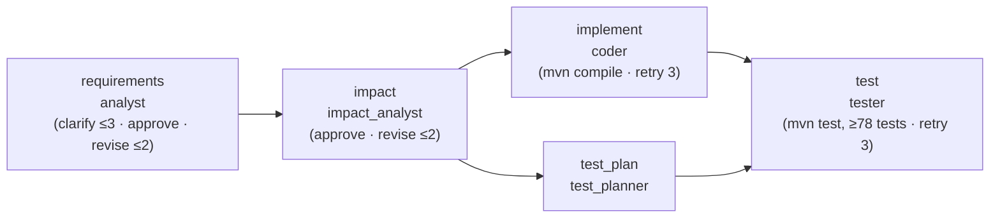
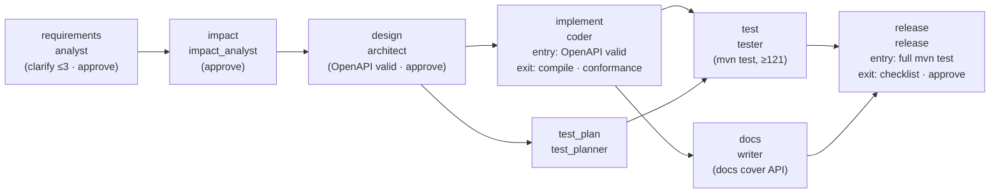
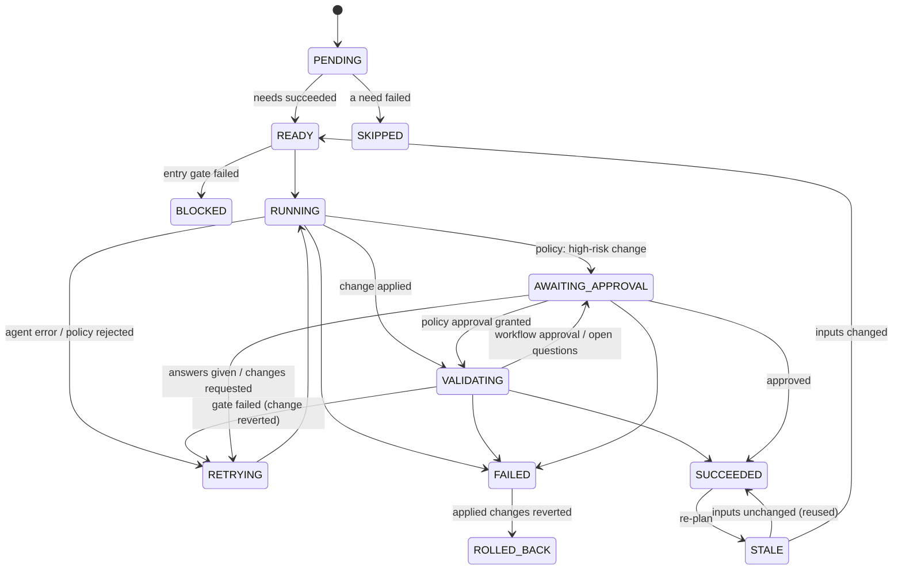
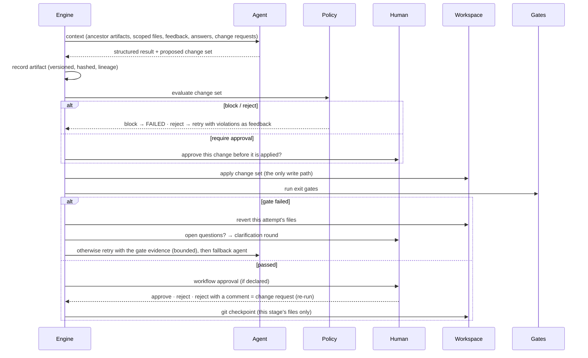

# Architecture

Two systems live in this repository:

| System | What it is | Where |
|---|---|---|
| **Orchestrator** | A governed, agentic SDLC engine (Python, ~4.7k lines): it turns a requirement into reviewed, tested code through a dependency graph of stages, with gates, policy, human checkpoints, rollback, resume, re-planning and an audit trail. | `orchestrator/` |
| **URL shortener** | The service the orchestrator built and then changed three times (Java 17, Spring Boot 3.4, ~1.6k lines + ~2.4k lines of tests), with its OpenAPI definition and docs. | `url-shortener/` |

The principle throughout: **agents propose, the orchestrator verifies, humans decide.** No agent writes a
file, judges its own output, or approves anything.

---

## 1. Components

| Component | Responsibility | Key files |
|---|---|---|
| Workflow DAG | Declarative stages: `needs`, entry/exit gates, approval mode, retry/fallback, read/write scopes, clarification rounds, revisions. Validated for cycles and unknown references before anything runs. | `engine/models.py`, `engine/dag.py`, `workflows/*.yaml` |
| Scheduler | Runs every READY stage concurrently (bounded); a stage with several `needs` is a join. Owns the attempt loop, budgets, stop file, resume and re-planning. | `engine/scheduler.py` |
| State machine | 12 explicit states with an enforced transition table; an illegal transition raises instead of corrupting the run. | `engine/state.py` |
| Event store | Append-only, hash-chained log: the single source of truth. State, metrics and resume are rebuilt from it; any edit, deletion or reordering is detected. | `engine/events.py` |
| Agents | One structured-output LLM call per attempt; output validated against a Pydantic model; files proposed through a scoped context. Deterministic stubs implement the same contract. | `agents/` |
| LLM backends | A provider-neutral contract (`LLMClient`), a registry (Anthropic, OpenAI, session), per-agent routing from config, and cassettes for offline replay. | `llm/` |
| Gates | Checks the orchestrator runs itself (never the agent's word): Maven compile/test with a test-count floor, ambiguity resolution, structural output checks, OpenAPI validity, two-way API conformance (documented = implemented), documentation coverage of the API, release checklist. | `gates/builtin.py`, `gates/api.py` |
| Policy engine | Rules over every proposed change set (secrets, dangerous code, PII in logs, dependency allowlist, high-impact paths, diff size), each mapped to a risk tier and an action. Policy-as-code; its hash is recorded on every run. | `policy/`, `policies/default.yaml` |
| Human checkpoints | Approvals (workflow-declared or policy-required), clarification rounds for open questions, change requests from commented rejections. Persisted and bound to content hashes. | `approvals/service.py` |
| Workspace | Change sets (the only path agent output reaches disk), file-level revert, workspace escape and symlink protection, git checkpoint per accepted stage. | `workspace/` |
| Observability | Metrics and Markdown/JSON reports computed purely from the event log. | `observability/` |

---

## 2. Orchestration model

### The dependency graph

A workflow is a DAG of stages. The brownfield workflow, for example:

`implement` and `test_plan` run **in parallel**; `test` **joins** them. Every stage can declare:
entry gates (preconditions), exit gates (verification), `approval: required`, `retry`, `fallback`,
`write_scope` / `read_scope` (least privilege, both ways), `clarification.max_rounds`, `max_revisions`,
`downstream_context` (show the agent where later stages write).

The **full lifecycle** (`workflows/lifecycle.yaml`) adds design, documentation and release readiness,
with two fork/join points and entry gates on implementation and release:

| Stage | Produces | Why the gate is there |
|---|---|---|
| `design` | `url-shortener/openapi.yaml`, `docs/design.md` | a human approves the contract before code is written; the validator rejects a malformed one |
| `implement` | code | entry: build only against a valid approved contract; exit: the code implements exactly what is documented, both ways |
| `docs` | `README.md`, `docs/api.md` | every documented path appears in the documentation |
| `release` | `CHANGELOG.md`, `docs/releases/<version>.md` | entry: release only from a build that is green *now*; exit: a failing checklist item blocks the release; a person signs off |

### Stage lifecycle

### One attempt, in order

Two properties of this order matter: **a human approves a risky change before it touches disk**, and
**a human approves verified output** (gates run before the workflow approval).

---

## 3. Cross-stage context and decision lineage

- Every attempt produces an **artifact**: versioned, content-hashed, and recording the exact
  `name@version#sha` of every upstream artifact it was built from (`engine/models.py: Artifact`).
- A stage receives **all accepted ancestor artifacts**, not only its direct dependencies (the tester
  needs the approved spec as much as the code).
- Human answers and reviewer change requests are **stamped onto the artifact verbatim**, so a
  downstream stage sees them even if an agent paraphrased or dropped one.
- Every decision is an event: agent assumptions (`DECISION_RECORDED`, source `assumption`), human
  answers (source `human`, with identity), approvals (`APPROVAL_DECIDED`, bound to an artifact hash),
  policy verdicts (`POLICY_EVALUATED`, with the policy file's hash).

## 4. Governance and autonomy boundaries

| Boundary | Mechanism |
|---|---|
| What an agent can see | `read_scope` globs; context over ~100k tokens is refused rather than silently truncated |
| What an agent can change | `write_scope` globs; writes are proposals; escapes (`..`, absolute, symlink) and out-of-scope paths fail the stage without retry |
| What a change may contain | Policy engine: `reject` (retry with feedback), `require_approval` (human, before apply), `flag`, `block` (final); a workflow cannot opt out |
| What counts as done | Gates the orchestrator runs: build, tests, minimum test count, ambiguity resolution |
| Who decides product questions | Clarification checkpoints; a non-human approver never answers them |
| Who accepts the result | Workflow approvals; content-bound, so a decision applies only to the exact artifact it was made on |
| How far an agent may go | Bounded retries, clarification rounds, revisions; cost and time budgets; `orch stop` |

## 5. Reliability

| Mechanism | Behaviour |
|---|---|
| Retries | Bounded per stage (≤10), with the failing gate's or policy's evidence fed back |
| Rollback | A failed attempt's applied files are restored or removed, file by file, never clobbering a file someone else changed since; a stage that fails for good ends `ROLLED_BACK` |
| Fallback | After retries or a refusal, one attempt with the `fallback` agent and all feedback so far |
| Safe-stop | `orch stop`, `--max-minutes`, `--max-cost-usd`: nothing new starts; the run ends `HALTED` |
| Resume | `orch resume` rebuilds state from the verified log; refuses a tampered log or artifact; resets unfinished stages; discards an interrupted stage's uncommitted files; reuses recorded LLM exchanges and human decisions |
| Re-planning | `orch replan --from <stage>` / `--requirement <file>` / an automatically detected requirement change: stale stages are reused if their lineage is unchanged and re-run otherwise |
| Git checkpoints | One commit per accepted stage, only its files, on a run-owned branch |

## 6. Data model: the event log

Each line is `{run_id, seq, ts, type, stage, payload, prev_hash, hash}`; `hash = sha256(canonical event
without hash)` and `prev_hash` chains to the previous event (genesis: 64 zeros). Event types:

| Group | Types |
|---|---|
| Run | `RUN_STARTED` (workflow, workflow/policy/requirement hashes, workspace, git, budgets) · `RUN_RESUMED` · `RUN_REPLANNED` · `RUN_HALTED` · `RUN_COMPLETED` |
| Stage | `STAGE_STATE` (from, to, reason) |
| Agent | `AGENT_INVOKED` (inputs, feedback) · `AGENT_COMPLETED` (LLM telemetry) · `AGENT_ERROR` · `FALLBACK_ENGAGED` |
| Output | `ARTIFACT_RECORDED` (lineage, file hashes, artifact-file hash) · `ARTIFACT_ACCEPTED` (`reused` on re-plan) · `DECISION_RECORDED` |
| Governance | `POLICY_EVALUATED` · `GATE_RESULT` · `APPROVAL_REQUESTED` / `APPROVAL_DECIDED` · `CLARIFICATION_REQUESTED` / `CLARIFICATION_ANSWERED` · `CHANGES_REQUESTED` |
| Workspace | `CHANGES_APPLIED` · `CHANGES_REVERTED` · `CHECKPOINT_COMMITTED` |

Per run directory: `events.jsonl`, `artifacts/<stage>.v<n>.json`, `approvals/` (requests, decisions,
readable answer files), `llm-requests/` (session requests and responses), `run.json` (settings, no secrets).

## 7. Agents and LLM backends

Each agent turn is **one structured-output request** (stable system prompt from
`agents/prompts/*.md`, one context message, a JSON schema generated from the agent's Pydantic output
model). The orchestrator owns the loop, so the model never drives control flow.

| Agent | Produces | Reads |
|---|---|---|
| analyst | normalized spec: goal, FR/NFR, ambiguities (assumption or open), acceptance criteria | the requirement, human answers |
| impact_analyst | impacted files, API and data changes, data flows, risks with detection, test strategy | approved spec, existing code |
| test_planner | test cases with ids, levels and checks | approved spec (and impact analysis) |
| coder | complete files (`pom.xml`, `src/main/**`) | spec, impact analysis, existing main code |
| tester | complete test files (`src/test/**`) | spec, impact, test plan, all code |

Backends are configuration (`config/llm.*.yaml`): `anthropic` (streaming, cached system prompt,
effort, server-side refusal fallback), `openai` (Responses API, strict JSON schema, `store=False`),
`session` (an assistant such as Claude Code answers through files, recorded as
`claude-code-session` at $0). Cassettes wrap whichever backends are used: `record` saves what is
missing, `replay` serves only saved exchanges (a miss fails the stage instead of making a paid call).

## 8. The URL shortener

Layered Spring Boot service: `api/` (controllers, DTOs, error handling, filters, metrics interceptor) →
`service/` (link lifecycle, policies, limiters, click recording) → `domain/` (JPA entities and
repositories) → file-based H2 with Flyway migrations (`V1__create_links`, `V2__create_click_events`).

| Endpoint | Behaviour |
|---|---|
| `POST /api/links` | Create: generated 8-char code or custom alias (3–32 `[A-Za-z0-9_-]`, reserved words refused), optional expiry; returns a one-time management token (stored only as SHA-256) |
| `GET /{code}` | 302 + `Cache-Control: no-store`; 410 expired; 404 unknown/deleted; 503 + `Retry-After: 5` if the store is down; best-effort click recording |
| `GET /api/links/{code}` | Public metadata |
| `PATCH /api/links/{code}` | Token-authorized: set a future `expiresAt` or remove it with `null` (a missing field is 400); 410 if already expired (never revived), 400 `invalid_expiry` for a non-future value; under the link's row lock |
| `GET /api/links/{code}/stats` | Private (token): total, 30 UTC days, last click; no visitor data |
| `DELETE /api/links/{code}` | Token-authorized; tombstone keeps the code reserved forever; clicks erased in the same transaction |
| `GET /health` | 200/503 by database reachability |
| `:8081/actuator/{health,metrics}` | Loopback-only management port; `shortener.redirects` timer by outcome |

Cross-cutting: destination policy (http/https, ≤2048 chars, no loopback/private/link-local/unique-local/
multicast targets, DNS fail-closed), per-IP create limit (20/min, Bucket4j), failed-token limit (10 per
rolling minute, shared by stats, delete and expiry changes), 16 KiB API body limit, security headers on
every response, one JSON error schema. The API is defined in `url-shortener/openapi.yaml` and documented
in `url-shortener/README.md` and `url-shortener/docs/api.md`.

## 9. Extension points

| To add | Do |
|---|---|
| A stage | Add it to a workflow YAML; no code |
| A gate | Subclass `Gate`, register in `gates/builtin.py` |
| A policy rule | Subclass `Rule`, add to `RULE_TYPES`, configure in `policies/*.yaml` |
| An agent | Subclass `LLMAgent` (prompt + output model + context sections), register in `llm_agents()` |
| An LLM provider | Implement `LLMClient`, `register_provider(...)` in `llm/factory.py` |
| An approval channel | Implement `Approver.decide` / `clarify` (e.g. Slack, a web UI) |
