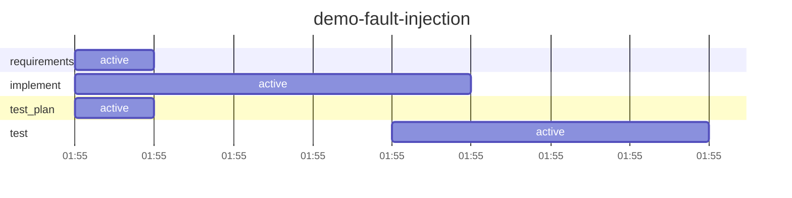

# Run report: `demo-fault-injection`

Workflow `fault-demo` · **SUCCEEDED** · 1 process(es) · 2026-11-01 01:55 → 2026-11-01 01:55 UTC

## Reliability

| Metric | Value |
|---|---|
| Stage success rate | 100% (4 succeeded) |
| Failure retries | 1 |
| Clarification rounds / change requests / fallbacks | 0 / 0 / 1 |
| Rollbacks (reverted change sets / stages ended ROLLED_BACK) | 1 / 0 |
| Incidents (unrecovered) | 2 (0) |
| MTTR | 2.7 s |
| Gate checks passed / failed | 5 / 1 |
| Policy evaluations by risk tier | low 5 |
| Re-plans | 0 |

## Latency

| | Time |
|---|---|
| End to end (wall clock) | 6.8 s |
| Active (agents, gates, orchestration) | 6.8 s |
| Waiting for humans | 0.0 s |
| Stopped between processes | 0.0 s |

| Stage | Attempts | Active | of which agent | of which gates | Waiting for humans | Outcomes |
|---|---|---|---|---|---|---|
| `requirements` | 1 | 0.0 s | 0.0 s | 0.0 s | 0.0 s | SUCCEEDED |
| `implement` | 2 | 3.7 s | 0.0 s | 2.6 s | 0.0 s | SUCCEEDED |
| `test_plan` | 1 | 0.1 s | 0.0 s | 0.0 s | 0.0 s | SUCCEEDED |
| `test` | 2 | 3.1 s | 0.0 s | 3.0 s | 0.0 s | SUCCEEDED |

## Human oversight

0 approval decision(s) (0 approved, 0 rejected, 0 with a change request), 0 clarification round(s) answering 0 question(s); 0 recorded decision(s) reused by resumes.

| Kind | Stage | Decision | By | Waited |
|---|---|---|---|---|

## Incidents

| Stage | Opened | Failures | Recovered after | First failure |
|---|---|---|---|---|
| `implement` | 01:55:25 | 1 | 2.4 s | exit gate(s) failed: ['maven_test'] |
| `test` | 01:55:28 | 1 | 3.1 s | fallback to agent 'tester' after: non-retryable agent error: model declined the request (category: demo fault  |

## LLM usage

0 call(s): . Live: 0 input / 0 output tokens, 0.0 s in calls, cost $0.00.

## Timeline

---

_Computed from the hash-chained event log only (`orch verify-audit` checks it). Retries are split by cause; clarification rounds and change requests are not failures. An incident opens at a stage's first failure (including a switch to the fallback agent) and closes at its next success; MTTR includes time a run sat stopped before a person fixed it. Stage success rate counts executed stages (SKIPPED ones never ran). Human decisions replayed by a resume are counted once._
