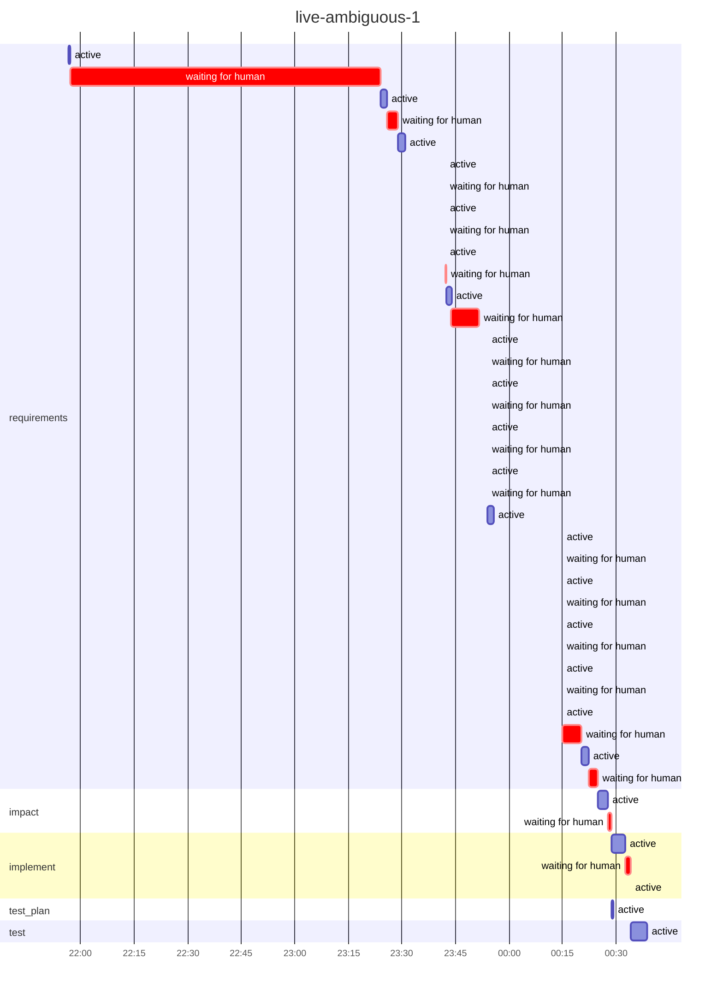

# Run report: `live-ambiguous-1`

Workflow `brownfield` · **SUCCEEDED** · 4 process(es) · 2026-10-31 21:56 → 2026-11-01 00:38 UTC

## Reliability

| Metric | Value |
|---|---|
| Stage success rate | 62% (3 failed, 12 skipped, 5 succeeded) |
| Failure retries | 0 |
| Clarification rounds / change requests / fallbacks | 12 / 2 / 0 |
| Rollbacks (reverted change sets / stages ended ROLLED_BACK) | 0 / 0 |
| Incidents (unrecovered) | 3 (0) |
| MTTR | 11.5 min |
| Gate checks passed / failed | 26 / 14 |
| Policy evaluations by risk tier | low 21, high 1 |
| Re-plans | 0 |

## Latency

| | Time |
|---|---|
| End to end (wall clock) | 2.7 h |
| Active (agents, gates, orchestration) | 20.6 min |
| Waiting for humans | 1.8 h |
| Stopped between processes | 32.8 min |

| Stage | Attempts | Active | of which agent | of which gates | Waiting for humans | Outcomes |
|---|---|---|---|---|---|---|
| `requirements` | 18 | 9.5 min | 9.5 min | 0.0 s | 1.8 h | FAILED, FAILED, FAILED, SUCCEEDED |
| `impact` | 1 | 2.8 min | 2.8 min | 0.0 s | 1.2 min | SKIPPED, SKIPPED, SKIPPED, SUCCEEDED |
| `implement` | 1 | 3.8 min | 3.8 min | 2.0 s | 1.5 min | SKIPPED, SKIPPED, SKIPPED, SUCCEEDED |
| `test_plan` | 1 | 26.7 s | 26.0 s | 0.0 s | 0.0 s | SKIPPED, SKIPPED, SKIPPED, SUCCEEDED |
| `test` | 1 | 4.5 min | 4.2 min | 18.7 s | 0.0 s | SKIPPED, SKIPPED, SKIPPED, SUCCEEDED |

## Human oversight

4 approval decision(s) (3 approved, 1 rejected, 1 with a change request), 4 clarification round(s) answering 16 question(s); 10 recorded decision(s) reused by resumes.

| Kind | Stage | Decision | By | Waited |
|---|---|---|---|---|
| workflow approval | `requirements` | rejected with change request | roopeshkotte | 7.7 min |
| workflow approval | `requirements` | approved | roopeshkotte | 2.4 min |
| workflow approval | `impact` | approved | roopeshkotte | 1.2 min |
| policy approval | `implement` | approved | roopeshkotte | 1.5 min |
| clarification round 1 | `requirements` | 8 answer(s) | roopeshkotte | 1.4 h |
| clarification round 2 | `requirements` | 6 answer(s) | roopeshkotte | 3.1 min |
| clarification round 3 | `requirements` | 1 answer(s) | roopeshkotte | 22.1 s |
| clarification round 4 | `requirements` | 1 answer(s) | roopeshkotte | 5.5 min |

## Incidents

| Stage | Opened | Failures | Recovered after | First failure |
|---|---|---|---|---|
| `requirements` | 23:30:49 | 1 | 13.0 min | exit gate(s) failed: ['ambiguities_resolved']; retries exhausted (1) |
| `requirements` | 23:51:33 | 1 | 2.3 min | rejected by roopeshkotte |
| `requirements` | 23:55:42 | 1 | 19.2 min | exit gate(s) failed: ['ambiguities_resolved']; retries exhausted (1) |

## LLM usage

22 call(s): 12 cassette, 8 live, 2 session. Live: 53,490 input / 88,089 output tokens, 12.7 min in calls, cost $0.00 (8 call(s) on an unpriced backend).

## Timeline

---

_Computed from the hash-chained event log only (`orch verify-audit` checks it). Retries are split by cause; clarification rounds and change requests are not failures. An incident opens at a stage's first failure (including a switch to the fallback agent) and closes when its work next passes its gates (a later wait for a sign-off is human wait); MTTR includes time a run sat stopped before a person fixed it. Stage success rate counts executed stages (SKIPPED ones never ran). Human decisions replayed by a resume are counted once._

