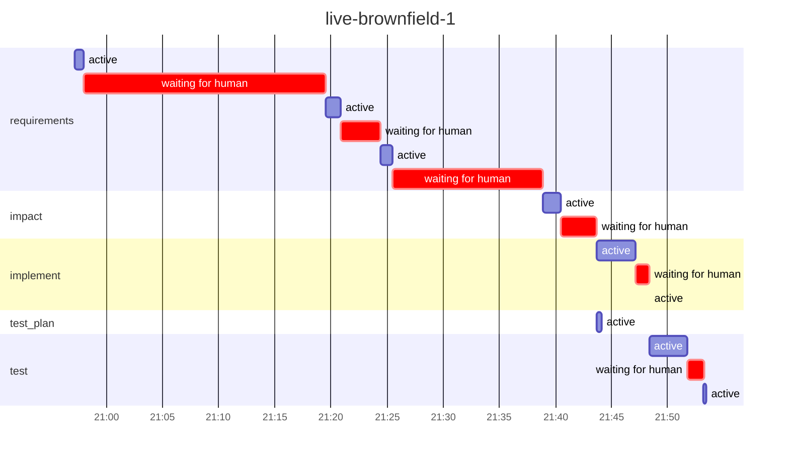

# Run report: `live-brownfield-1`

Workflow `brownfield` · **SUCCEEDED** · 1 process(es) · 2026-10-31 20:57 → 2026-10-31 21:53 UTC

## Reliability

| Metric | Value |
|---|---|
| Stage success rate | 100% (5 succeeded) |
| Failure retries | 0 |
| Clarification rounds / change requests / fallbacks | 2 / 0 / 0 |
| Rollbacks (reverted change sets / stages ended ROLLED_BACK) | 0 / 0 |
| Incidents (unrecovered) | 0 (0) |
| MTTR | – |
| Gate checks passed / failed | 8 / 2 |
| Policy evaluations by risk tier | low 5, high 2 |
| Re-plans | 0 |

## Latency

| | Time |
|---|---|
| End to end (wall clock) | 56.2 min |
| Active (agents, gates, orchestration) | 11.8 min |
| Waiting for humans | 44.4 min |
| Stopped between processes | 0.0 s |

| Stage | Attempts | Active | of which agent | of which gates | Waiting for humans | Outcomes |
|---|---|---|---|---|---|---|
| `requirements` | 3 | 3.2 min | 3.2 min | 0.0 s | 38.6 min | SUCCEEDED |
| `impact` | 1 | 1.6 min | 1.6 min | 0.0 s | 3.2 min | SUCCEEDED |
| `implement` | 1 | 3.5 min | 3.4 min | 2.0 s | 1.2 min | SUCCEEDED |
| `test_plan` | 1 | 24.5 s | 23.6 s | 0.0 s | 0.0 s | SUCCEEDED |
| `test` | 1 | 3.6 min | 3.4 min | 12.2 s | 1.5 min | SUCCEEDED |

## Human oversight

4 approval decision(s) (4 approved, 0 rejected, 0 with a change request), 2 clarification round(s) answering 4 question(s); 0 recorded decision(s) reused by resumes.

| Kind | Stage | Decision | By | Waited |
|---|---|---|---|---|
| workflow approval | `requirements` | approved | roopeshkotte | 13.4 min |
| workflow approval | `impact` | approved | roopeshkotte | 3.2 min |
| policy approval | `implement` | approved | roopeshkotte | 1.2 min |
| policy approval | `test` | approved | roopeshkotte | 1.5 min |
| clarification round 1 | `requirements` | 3 answer(s) | roopeshkotte | 21.6 min |
| clarification round 2 | `requirements` | 1 answer(s) | roopeshkotte | 3.6 min |

## LLM usage

7 call(s): 5 live, 2 session. Live: 27,828 input / 35,336 output tokens, 5.1 min in calls, cost $0.00 (5 call(s) on an unpriced backend).

## Timeline

---

_Computed from the hash-chained event log only (`orch verify-audit` checks it). Retries are split by cause; clarification rounds and change requests are not failures. An incident opens at a stage's first failure (including a switch to the fallback agent) and closes at its next success; MTTR includes time a run sat stopped before a person fixed it. Stage success rate counts executed stages (SKIPPED ones never ran). Human decisions replayed by a resume are counted once._
