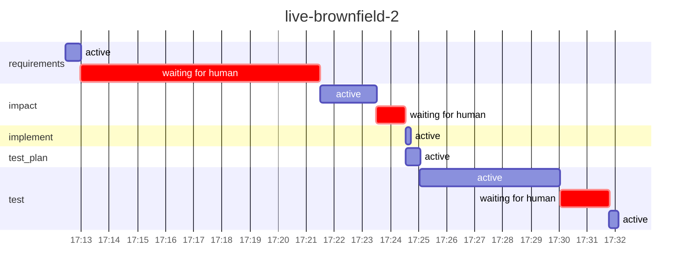

# Run report: `live-brownfield-2`

Workflow `brownfield` · **SUCCEEDED** · 1 process(es) · 2026-11-02 17:12 → 2026-11-02 17:32 UTC

Workflow chosen by `orch run auto`: proposed `brownfield` (high confidence, by model) from `brownfield`, `bugfix`, `lifecycle`; confirmed by roopeshkotte. This is a test-suite hardening change: the tests need to reliably verify an intended interleaving, while production behavior and API contracts remain unchanged. It does not report a defect in the service itself or request documentation or release preparation.

## Reliability

| Metric | Value |
|---|---|
| Stage success rate | 100% (5 succeeded) |
| Failure retries | 0 |
| Clarification rounds / change requests / fallbacks | 0 / 0 / 0 |
| Rollbacks (reverted change sets / stages ended ROLLED_BACK) | 0 / 0 |
| Incidents (unrecovered) | 0 (0) |
| MTTR | – |
| Gate checks passed / failed | 6 / 0 |
| Policy evaluations by risk tier | low 4, high 1 |
| Re-plans | 0 |

## Latency

| | Time |
|---|---|
| End to end (wall clock) | 19.7 min |
| Active (agents, gates, orchestration) | 8.4 min |
| Waiting for humans | 11.3 min |
| Stopped between processes | 0.0 s |

| Stage | Attempts | Active | of which agent | of which gates | Waiting for humans | Outcomes |
|---|---|---|---|---|---|---|
| `requirements` | 1 | 32.5 s | 32.5 s | 0.0 s | 8.5 min | SUCCEEDED |
| `impact` | 1 | 2.0 min | 2.0 min | 0.0 s | 1.0 min | SUCCEEDED |
| `implement` | 1 | 10.1 s | 7.7 s | 2.4 s | 0.0 s | SUCCEEDED |
| `test_plan` | 1 | 30.3 s | 29.4 s | 0.0 s | 0.0 s | SUCCEEDED |
| `test` | 1 | 5.3 min | 5.0 min | 18.7 s | 1.8 min | SUCCEEDED |

## Human oversight

3 approval decision(s) (3 approved, 0 rejected, 0 with a change request), 0 clarification round(s) answering 0 question(s); 0 recorded decision(s) reused by resumes.

| Kind | Stage | Decision | By | Waited |
|---|---|---|---|---|
| workflow approval | `requirements` | approved | roopeshkotte | 8.5 min |
| workflow approval | `impact` | approved | roopeshkotte | 1.0 min |
| policy approval | `test` | approved | roopeshkotte | 1.8 min |

## LLM usage

5 call(s): 3 live, 2 session. Live: 49,053 input / 16,459 output tokens, 3.0 min in calls, cost $0.00 (3 call(s) on an unpriced backend).

## Timeline

---

_Computed from the hash-chained event log only (`orch verify-audit` checks it). Retries are split by cause; clarification rounds and change requests are not failures. An incident opens at a stage's first failure (including a switch to the fallback agent) and closes when its work next passes its gates (a later wait for a sign-off is human wait); MTTR includes time a run sat stopped before a person fixed it. Stage success rate counts executed stages (SKIPPED ones never ran). Human decisions replayed by a resume are counted once._

