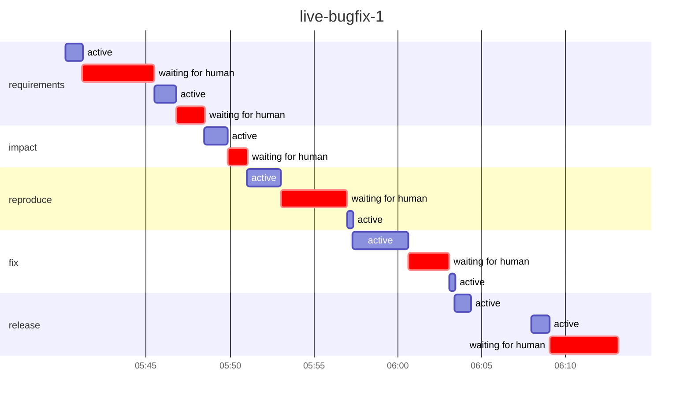

# Run report: `live-bugfix-1`

Workflow `bugfix` · **SUCCEEDED** · 2 process(es) · 2026-11-02 05:40 → 2026-11-02 06:13 UTC

## Reliability

| Metric | Value |
|---|---|
| Stage success rate | 83% (1 rolled_back, 5 succeeded) |
| Failure retries | 0 |
| Clarification rounds / change requests / fallbacks | 1 / 0 / 0 |
| Rollbacks (reverted change sets / stages ended ROLLED_BACK) | 1 / 1 |
| Incidents (unrecovered) | 1 (0) |
| MTTR | 4.7 min |
| Gate checks passed / failed | 12 / 2 |
| Policy evaluations by risk tier | low 5, high 2 |
| Re-plans | 1 |

## Latency

| | Time |
|---|---|
| End to end (wall clock) | 32.9 min |
| Active (agents, gates, orchestration) | 11.7 min |
| Waiting for humans | 17.6 min |
| Stopped between processes | 3.6 min |

| Stage | Attempts | Active | of which agent | of which gates | Waiting for humans | Outcomes |
|---|---|---|---|---|---|---|
| `requirements` | 2 | 2.3 min | 2.3 min | 0.0 s | 6.0 min | SUCCEEDED |
| `impact` | 1 | 1.4 min | 1.4 min | 0.0 s | 1.2 min | SUCCEEDED |
| `reproduce` | 1 | 2.3 min | 2.0 min | 20.1 s | 3.9 min | SUCCEEDED |
| `fix` | 1 | 3.6 min | 3.3 min | 19.7 s | 2.5 min | SUCCEEDED |
| `release` | 2 | 2.0 min | 1.4 min | 36.1 s | 4.1 min | ROLLED_BACK, SUCCEEDED |

## Human oversight

5 approval decision(s) (5 approved, 0 rejected, 0 with a change request), 1 clarification round(s) answering 1 question(s); 0 recorded decision(s) reused by resumes.

| Kind | Stage | Decision | By | Waited |
|---|---|---|---|---|
| workflow approval | `requirements` | approved | roopeshkotte | 1.7 min |
| workflow approval | `impact` | approved | roopeshkotte | 1.2 min |
| policy approval | `reproduce` | approved | roopeshkotte | 3.9 min |
| policy approval | `fix` | approved | roopeshkotte | 2.5 min |
| workflow approval | `release` | approved | roopeshkotte | 4.1 min |
| clarification round 1 | `requirements` | 1 answer(s) | roopeshkotte | 4.3 min |

## Incidents

| Stage | Opened | Failures | Recovered after | First failure |
|---|---|---|---|---|
| `release` | 06:04:22 | 1 | 4.7 min | exit gate(s) failed: ['release_checklist_passed']; retries exhausted (1) |

## LLM usage

7 call(s): 6 live, 1 session. Live: 98,460 input / 43,237 output tokens, 7.1 min in calls, cost $0.00 (6 call(s) on an unpriced backend).

## Timeline

---

_Computed from the hash-chained event log only (`orch verify-audit` checks it). Retries are split by cause; clarification rounds and change requests are not failures. An incident opens at a stage's first failure (including a switch to the fallback agent) and closes when its work next passes its gates (a later wait for a sign-off is human wait); MTTR includes time a run sat stopped before a person fixed it. Stage success rate counts executed stages (SKIPPED ones never ran). Human decisions replayed by a resume are counted once._

