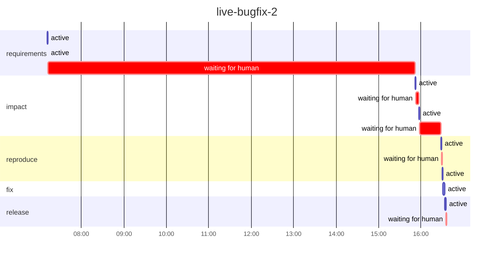

# Run report: `live-bugfix-2`

Workflow `bugfix` · **SUCCEEDED** · 2 process(es) · 2026-11-02 07:11 → 2026-11-02 16:36 UTC

Workflow chosen by `orch run auto`: proposed `bugfix` (high confidence, by model) from `brownfield`, `bugfix`, `lifecycle`; confirmed by roopeshkotte. This is a defect in the existing service: malformed percent-escapes currently produce an HTML 400 response, contrary to the expected JSON error behavior. The request asks to restore the existing error contract while keeping the status code and other handling unchanged, not to introduce an API change or prepare API documentation or release readiness.

## Reliability

| Metric | Value |
|---|---|
| Stage success rate | 83% (1 failed, 4 skipped, 5 succeeded) |
| Failure retries | 0 |
| Clarification rounds / change requests / fallbacks | 0 / 1 / 0 |
| Rollbacks (reverted change sets / stages ended ROLLED_BACK) | 0 / 0 |
| Incidents (unrecovered) | 1 (0) |
| MTTR | 36.7 s |
| Gate checks passed / failed | 13 / 1 |
| Policy evaluations by risk tier | low 6, high 1 |
| Re-plans | 1 |

## Latency

| | Time |
|---|---|
| End to end (wall clock) | 9.4 h |
| Active (agents, gates, orchestration) | 8.4 min |
| Waiting for humans | 9.3 h |
| Stopped between processes | 36.7 s |

| Stage | Attempts | Active | of which agent | of which gates | Waiting for humans | Outcomes |
|---|---|---|---|---|---|---|
| `requirements` | 2 | 31.8 s | 31.8 s | 0.0 s | 8.6 h | FAILED, SUCCEEDED |
| `impact` | 2 | 2.1 min | 2.1 min | 0.0 s | 34.8 min | SKIPPED, SUCCEEDED |
| `reproduce` | 1 | 1.1 min | 48.0 s | 19.6 s | 1.2 min | SKIPPED, SUCCEEDED |
| `fix` | 1 | 3.3 min | 2.6 min | 42.1 s | 0.0 s | SKIPPED, SUCCEEDED |
| `release` | 1 | 1.3 min | 52.9 s | 27.7 s | 57.2 s | SKIPPED, SUCCEEDED |

## Human oversight

5 approval decision(s) (4 approved, 1 rejected, 1 with a change request), 0 clarification round(s) answering 0 question(s); 0 recorded decision(s) reused by resumes.

| Kind | Stage | Decision | By | Waited |
|---|---|---|---|---|
| workflow approval | `requirements` | approved | roopeshkotte | 8.6 h |
| workflow approval | `impact` | rejected with change request | roopeshkotte | 4.7 min |
| workflow approval | `impact` | approved | roopeshkotte | 30.1 min |
| policy approval | `reproduce` | approved | roopeshkotte | 1.2 min |
| workflow approval | `release` | approved | roopeshkotte | 57.1 s |

## Incidents

| Stage | Opened | Failures | Recovered after | First failure |
|---|---|---|---|---|
| `requirements` | 07:12:10 | 1 | 36.7 s | exit gate(s) failed: ['outputs_present']; retries exhausted (1) |

## LLM usage

7 call(s): 1 cassette, 5 live, 1 session. Live: 138,767 input / 25,614 output tokens, 4.3 min in calls, cost $0.00 (5 call(s) on an unpriced backend).

## Timeline

---

_Computed from the hash-chained event log only (`orch verify-audit` checks it). Retries are split by cause; clarification rounds and change requests are not failures. An incident opens at a stage's first failure (including a switch to the fallback agent) and closes when its work next passes its gates (a later wait for a sign-off is human wait); MTTR includes time a run sat stopped before a person fixed it. Stage success rate counts executed stages (SKIPPED ones never ran). Human decisions replayed by a resume are counted once._

