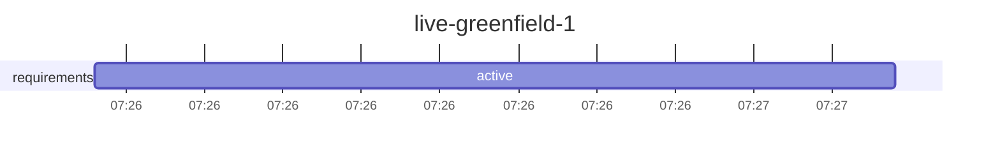

# Run report: `live-greenfield-1`

Workflow `skeleton` · **FAILED** · 1 process(es) · 2026-10-30 07:26 → 2026-10-30 07:27 UTC

## Reliability

| Metric | Value |
|---|---|
| Stage success rate | 0% (1 failed, 3 skipped) |
| Failure retries | 0 |
| Clarification rounds / change requests / fallbacks | 0 / 0 / 0 |
| Rollbacks (reverted change sets / stages ended ROLLED_BACK) | 0 / 0 |
| Incidents (unrecovered) | 1 (1) |
| MTTR | – |
| Gate checks passed / failed | 1 / 1 |
| Policy evaluations by risk tier | low 1 |
| Re-plans | 0 |

## Latency

| | Time |
|---|---|
| End to end (wall clock) | 50.0 s |
| Active (agents, gates, orchestration) | 50.0 s |
| Waiting for humans | 0.0 s |
| Stopped between processes | 0.0 s |

| Stage | Attempts | Active | of which agent | of which gates | Waiting for humans | Outcomes |
|---|---|---|---|---|---|---|
| `requirements` | 1 | 50.0 s | 50.0 s | 0.0 s | 0.0 s | FAILED |
| `implement` | 0 | 0.0 s | 0.0 s | 0.0 s | 0.0 s | SKIPPED |
| `test_plan` | 0 | 0.0 s | 0.0 s | 0.0 s | 0.0 s | SKIPPED |
| `test` | 0 | 0.0 s | 0.0 s | 0.0 s | 0.0 s | SKIPPED |

## Human oversight

0 approval decision(s) (0 approved, 0 rejected, 0 with a change request), 0 clarification round(s) answering 0 question(s); 0 recorded decision(s) reused by resumes.

| Kind | Stage | Decision | By | Waited |
|---|---|---|---|---|

## Incidents

| Stage | Opened | Failures | Recovered after | First failure |
|---|---|---|---|---|
| `requirements` | 07:27:08 | 1 | not recovered | exit gate(s) failed: ['ambiguities_resolved']; retries exhausted (1) |

## LLM usage

1 call(s): 1 live. Live: 858 input / 6,749 output tokens, 50.0 s in calls, cost $0.00 (1 call(s) on an unpriced backend).

## Timeline

---

_Computed from the hash-chained event log only (`orch verify-audit` checks it). Retries are split by cause; clarification rounds and change requests are not failures. An incident opens at a stage's first failure (including a switch to the fallback agent) and closes when its work next passes its gates (a later wait for a sign-off is human wait); MTTR includes time a run sat stopped before a person fixed it. Stage success rate counts executed stages (SKIPPED ones never ran). Human decisions replayed by a resume are counted once._

