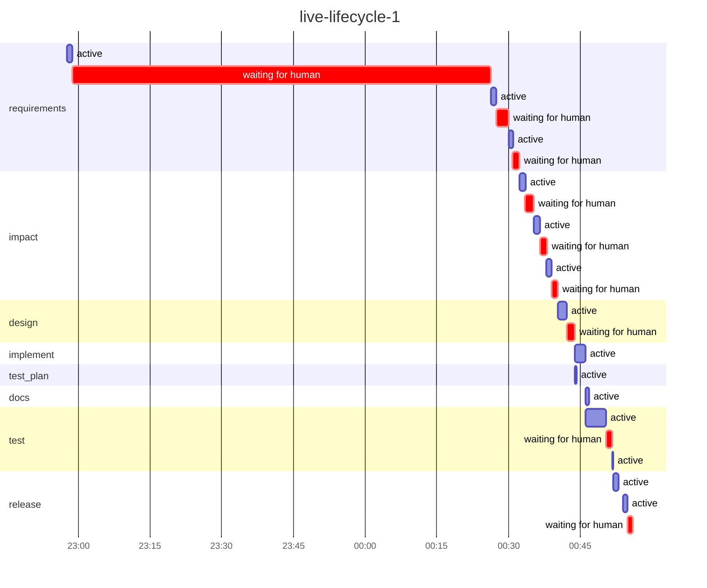

# Run report: `live-lifecycle-1`

Workflow `lifecycle` · **SUCCEEDED** · 2 process(es) · 2026-11-01 22:57 → 2026-11-02 00:55 UTC

## Reliability

| Metric | Value |
|---|---|
| Stage success rate | 89% (1 rolled_back, 8 succeeded) |
| Failure retries | 0 |
| Clarification rounds / change requests / fallbacks | 2 / 2 / 0 |
| Rollbacks (reverted change sets / stages ended ROLLED_BACK) | 1 / 1 |
| Incidents (unrecovered) | 1 (0) |
| MTTR | 2.0 min |
| Gate checks passed / failed | 19 / 3 |
| Policy evaluations by risk tier | low 12, high 1 |
| Re-plans | 0 |

## Latency

| | Time |
|---|---|
| End to end (wall clock) | 2.0 h |
| Active (agents, gates, orchestration) | 17.7 min |
| Waiting for humans | 1.7 h |
| Stopped between processes | 59.1 s |

| Stage | Attempts | Active | of which agent | of which gates | Waiting for humans | Outcomes |
|---|---|---|---|---|---|---|
| `requirements` | 3 | 3.2 min | 3.2 min | 0.0 s | 1.5 h | SUCCEEDED |
| `impact` | 3 | 3.8 min | 3.8 min | 0.0 s | 4.3 min | SUCCEEDED |
| `design` | 1 | 1.8 min | 1.8 min | 0.1 s | 1.7 min | SUCCEEDED |
| `implement` | 1 | 2.4 min | 2.3 min | 2.9 s | 0.0 s | SUCCEEDED |
| `test_plan` | 1 | 30.5 s | 29.4 s | 0.0 s | 0.0 s | SUCCEEDED |
| `docs` | 1 | 37.3 s | 37.1 s | 0.0 s | 0.0 s | SUCCEEDED |
| `test` | 1 | 4.5 min | 4.2 min | 20.1 s | 1.3 min | SUCCEEDED |
| `release` | 2 | 2.0 min | 1.4 min | 37.2 s | 1.0 min | ROLLED_BACK, SUCCEEDED |

## Human oversight

7 approval decision(s) (5 approved, 2 rejected, 2 with a change request), 2 clarification round(s) answering 3 question(s); 0 recorded decision(s) reused by resumes.

| Kind | Stage | Decision | By | Waited |
|---|---|---|---|---|
| workflow approval | `requirements` | approved | roopeshkotte | 1.3 min |
| workflow approval | `impact` | rejected with change request | roopeshkotte | 1.7 min |
| workflow approval | `impact` | rejected with change request | roopeshkotte | 1.3 min |
| workflow approval | `impact` | approved | roopeshkotte | 1.3 min |
| workflow approval | `design` | approved | roopeshkotte | 1.7 min |
| policy approval | `test` | approved | roopeshkotte | 1.3 min |
| workflow approval | `release` | approved | roopeshkotte | 1.0 min |
| clarification round 1 | `requirements` | 2 answer(s) | roopeshkotte | 1.5 h |
| clarification round 2 | `requirements` | 1 answer(s) | roopeshkotte | 2.5 min |

## Incidents

| Stage | Opened | Failures | Recovered after | First failure |
|---|---|---|---|---|
| `release` | 00:52:56 | 1 | 2.0 min | exit gate(s) failed: ['release_checklist_passed']; retries exhausted (1) |

## LLM usage

13 call(s): 11 live, 2 session. Live: 187,865 input / 76,712 output tokens, 11.2 min in calls, cost $0.00 (11 call(s) on an unpriced backend).

## Timeline

---

_Computed from the hash-chained event log only (`orch verify-audit` checks it). Retries are split by cause; clarification rounds and change requests are not failures. An incident opens at a stage's first failure (including a switch to the fallback agent) and closes when its work next passes its gates (a later wait for a sign-off is human wait); MTTR includes time a run sat stopped before a person fixed it. Stage success rate counts executed stages (SKIPPED ones never ran). Human decisions replayed by a resume are counted once._

